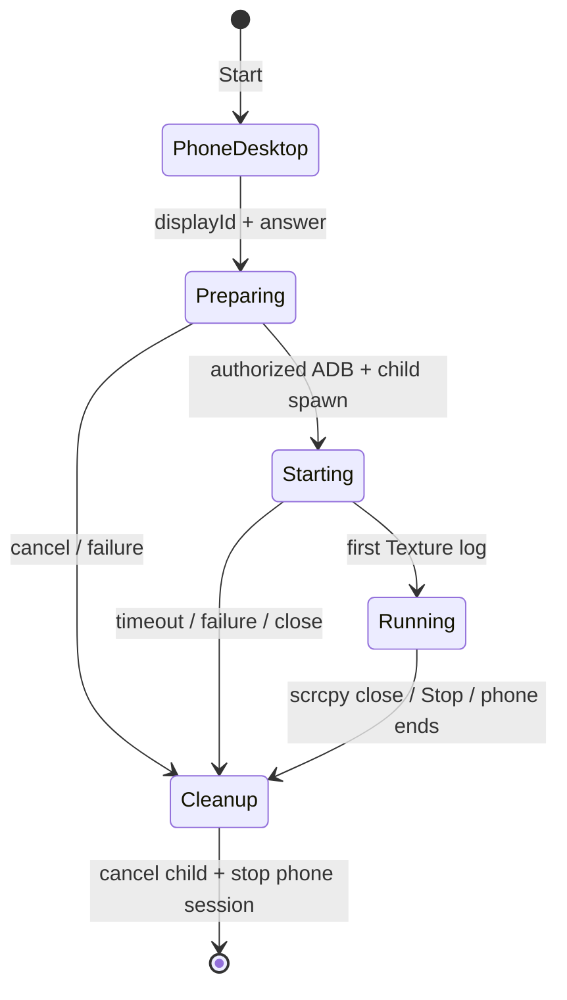

# Integrated scrcpy desktop backend

## What and why

The user requested integrating the experimentally verified scrcpy/full-Motorola-desktop
combination into Smart Connect. Desktop gains an explicit built-in/scrcpy selector plus ADB
target/port and software-decode settings. Existing preferences default to built-in. Quality,
resolution, scaling and borderless controls remain on the same page.

## Architecture and lifetime

`shared/desktop_renderer.rs` validates backend/options. `mirror/src/scrcpy.rs` owns the ADB
checks and child worker; `Session` owns its cancellable link. GUI sends a single desktop request,
then reads local preparation/running/error state. Child launch and ADB waits never run on the
host or GTK event loop. A PTY forces prompt line-buffered diagnostics without depending on
external stdbuf. Metadata lines are bounded and the selected serial is redacted; ADB device
rows are suppressed. The common rotating logger still applies address/credential filtering.

The owner's WebRTC pipeline drains compressed video to a fakesink, rather than creating an
extra GL window and decoder. It remains a normal desktop session (not a short-lived notification
headless action), retains the 30-second heartbeat and skips decoder-stall recovery. scrcpy
captures the discovered display ID and receives encoder/FPS/borderless options. No `--new-display`
or unverified phone protocol parameters are used. The second phone encoder remains necessary;
pausing it might change display lifetime/content and is deliberately not assumed safe.

Auto ADB selection prefers the paired peer IP, then a sole authorized device; with none it
tries the configured network port. Explicit targets handle multiple devices. Pairing and phone
approval are not automated. CLI tools resolve via documented environment overrides, executable
siblings, then PATH. Optional decoder override is checked against installed CLI help.

Closing the viewer closes the phone desktop. Stopping/restarting the source cancels its worker,
signals only the owned child group, escalates after a short grace and reaps it. A Linux
parent-death signal also prevents the viewer outliving a killed host. The GTK window can close
to tray without taking ownership away from the host. Startup failure removes the owner session
and remains visible as `desktopError` until retry.

## Validation

Normal suites include fake-process tests for selection, first-frame detection, cancellation,
missing binary and scoped cleanup. The isolated GTK desktop test covers settings/preservation.
Actual-device startup, error, close and backend-switch checks are recorded below after deployment.

Release validation passed: 65 mirror tests and 47 GUI tests, plus the isolated native GTK
desktop settings test. The latter caught intermediate EntryRow text changes overwriting a
saved ADB target; the field now commits on Apply or Start, while changes only validate locally.

Actual-device validation on Motorola Android 16 / scrcpy 5.0.1 passed:
- The integrated 1280x720 stream reached `running`; the child argv contained the actual display
  ID, 2 Mbit/s, 20 FPS and borderless options, with no `--new-display` argument.
- There was one visible scrcpy window and no owner GL window; owner renderer stats were null
  and the log explicitly reported compressed draining without a decoder.
- API Stop reaped the owned child and removed the source session. A normal window-manager
  close also ended the source without an error.
- An intentionally missing ADB target produced a visible error and removed its source.
- Switching back to built-in mode rendered successfully, clearing the previous error.
- The final 2880x1920 scrcpy stream showed the full taskbar on visual inspection. Initial
  first-frame snapshots can precede taskbar initialization; a settled frame confirmed it.
- Terminating and restarting the GTK GUI while the final desktop was active retained the same
  host session and scrcpy child. The daemon stayed running throughout.

The latest host/GUI were deployed, with the user's desktop backend selected as scrcpy. Existing
resolution, scaling, borderless, app, language and other preference values were preserved;
only backend/ADB defaults were added. The final viewer remains available to the user. No raw
research data or device identifiers were added to the repository, and AGENTS.md stayed unchanged.
